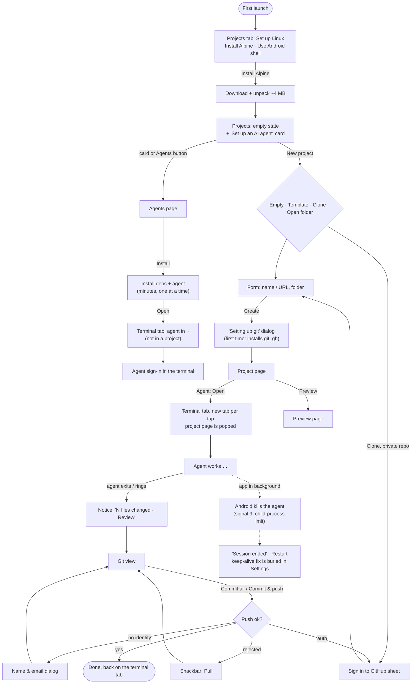
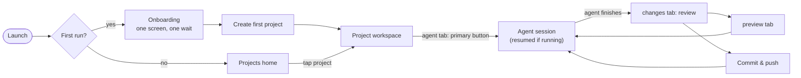
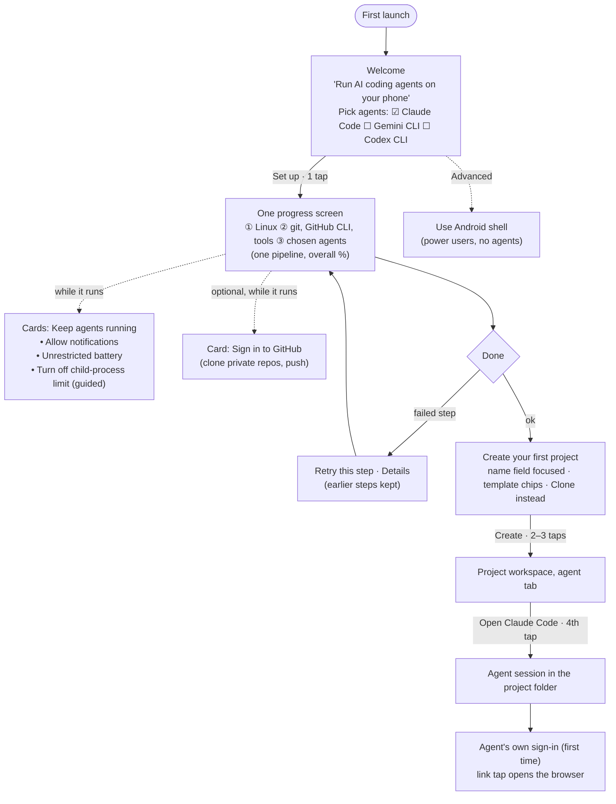
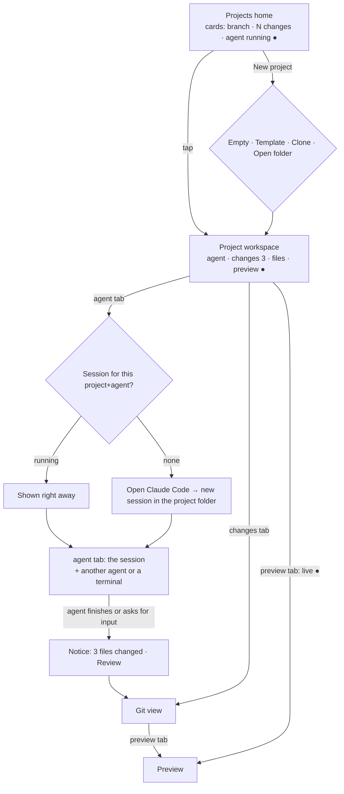
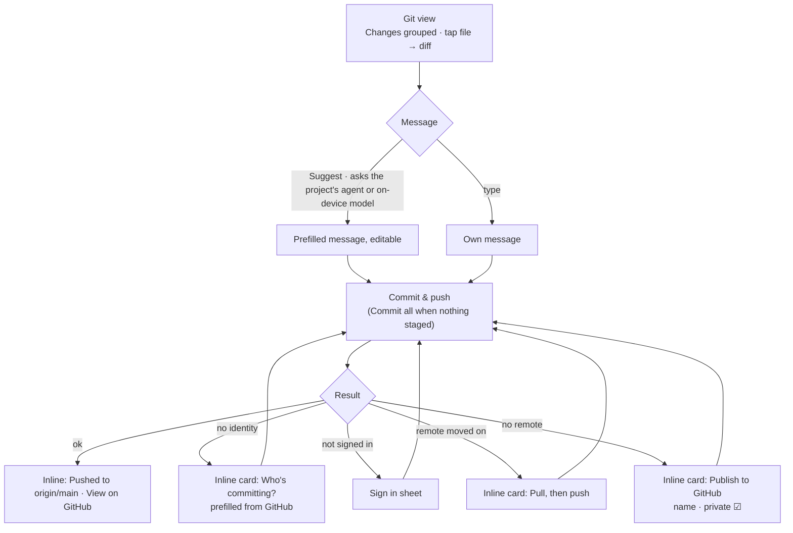
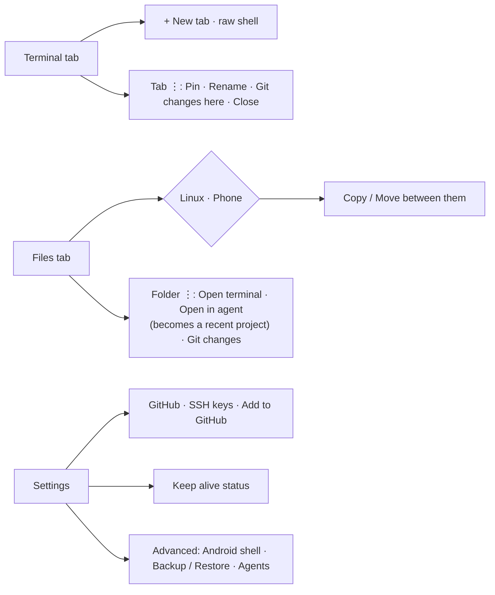
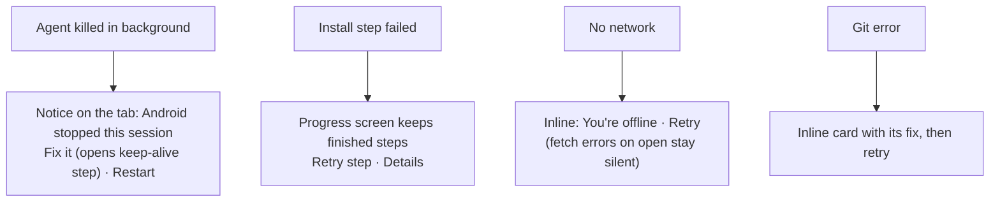
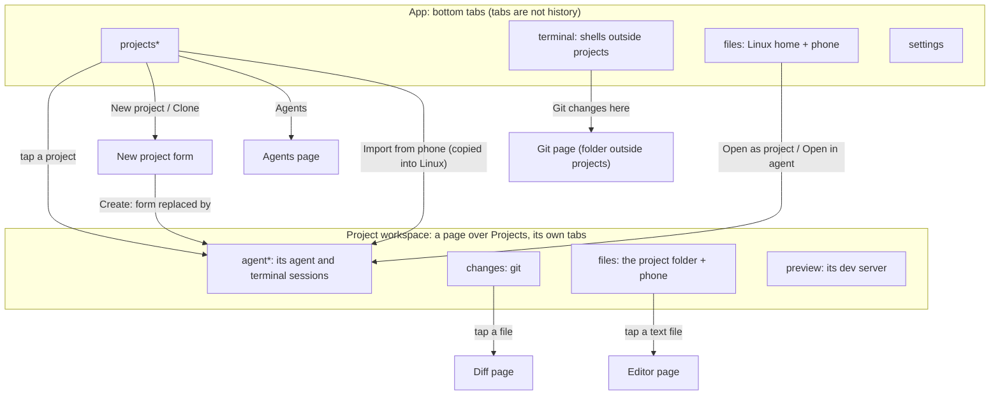

# aiterm user flow

aiterm exists for one job: **run an AI coding agent on a real project, from a phone, and ship what it builds.** Linux, the terminal, files and git are the means to that end. This document maps how a user gets through that job today, where it costs them effort, and the flow we are building towards.

- [1. Who and what](#1-who-and-what)
- [2. The flow today](#2-the-flow-today)
- [3. Friction inventory](#3-friction-inventory)
- [4. Principles](#4-principles)
- [5. The target flow](#5-the-target-flow)
- [6. Screen by screen](#6-screen-by-screen)
- [7. Implementation plan](#7-implementation-plan)
- [8. How we measure it](#8-how-we-measure-it)

## 1. Who and what

| User | Wants | Must never be forced to |
|---|---|---|
| **Builder**: has a Claude/ChatGPT/Gemini account, may never have used a terminal | Describe an app, watch an agent build it, see it running, put it on GitHub | Know what Alpine, proot, apk or `git add` are |
| **Developer**: uses git and a terminal daily | Their repos and their agent on the phone, the same as on a laptop | Fight the UI to reach a shell, files or real git |

Both share one loop: **open project → run agent → review changes → preview → commit & push.** Everything in the app should either move a user along that loop or stay out of the way.

## 2. The flow today

As built in build #29 (Projects home, git UI, one-tap agents).

## 3. Friction inventory

Ordered by how much each one costs a first-time Builder. *Where* points at the code to change.

| # | Friction | Why it hurts | Where |
|---|---|---|---|
| F1 | **Android kills long agent runs** (phantom-process limit, battery optimisation), and the fix lives deep in Settings | The core job fails silently mid-task; the user blames the app or the agent | `keep_alive/`, `settings_screen.dart` `_KeepAliveSection` |
| F2 | **Setup happens in four separate waits**: Linux, then each agent, then git on first project, then GitHub on first clone/push | Four spinners, each discovered only by tapping into it; one install at a time | `setup_view.dart`, `agent_installer.dart` (`busy`), `git_actions.dart` `ensureGitTools` |
| F3 | **Setup copy is technical**: "Alpine", "proot", "apk", plus a competing "Use Android shell" button | The Builder must decide something they can't evaluate; the Android shell can't run agents | `setup_view.dart` |
| F4 | **The first agent opens outside any project** (in `~`) | The agent's work has no home, no git, no review; teaches the wrong model | `agents_screen.dart` → `AgentInstaller.open` with no `cwd` |
| F5 | **Opening an agent leaves the project**: the project page is popped, and Back lands on the Projects list | The user loses their place; getting back to "Changes" takes 3 taps | `AppNavigation._toTabs`, `project_screen.dart` |
| F6 | **Every "Open" makes a new tab** | Tabs pile up ("Claude Code · app", "Claude Code · app"…); a running conversation is easy to lose | `AgentInstaller.open` → `TerminalTabs.open` |
| F7 | **Terminal tabs don't show which project they belong to**, and there is no way back from a tab to its project | The terminal tab and the project feel like two apps | `tab_strip.dart` |
| F8 | **The project page gives three agents equal weight** | Most users use one agent per project; the main action is one row among many | `project_screen.dart` Agents card |
| F9 | **Folders opened in an agent from Files aren't projects** | Two ways to work, only one has changes/review/preview | `files_screen.dart` `_openInAgent` |
| F10 | **Writing a commit message on a phone keyboard** | The slowest step of the review loop | `git_screen.dart` `_CommitBar` |
| F11 | **Preview is only discoverable after a server starts**, and only as a transient banner or a project-page row | "Where is my app?" is the Builder's first question after the agent finishes | `terminal_screen.dart` `_PortAnnouncement`, `project_screen.dart` |
| F12 | **Errors arrive as snackbars that vanish** (clone failures excepted) | Hard to act on with a keyboard up; the next step is easily missed | `git_actions.dart` `runGit` |

What already works and should be kept: no long-press-only gestures; every row has a visible ⋮; git errors offer their fix and retry; the review notice after an agent finishes; one-tap installs that handle dependencies.

## 4. Principles

1. **One setup, front-loaded, in parallel.** Ask once, install everything in one progress screen, and use the wait to handle permissions.
2. **Everything happens in a project.** Any folder an agent works in is a project (at least a recent one), so review, preview and git always have a home.
3. **The project is the anchor; the terminal is a view of it.** The user can always get from a tab to its project and back in one tap.
4. **Resume, don't duplicate.** Opening an agent for a project brings back its running session.
5. **The next step is always on screen**: never only in a snackbar, never behind a gesture.
6. **Power is one level down, never removed.** Raw terminal, Files, real git and the Android shell stay reachable; they just aren't in the Builder's path.

## 5. The target flow

### 5.1 Overview

### 5.2 First run: one screen, one wait

Goal: **from install to a running agent inside a project in 4 taps**, with every permission granted while the downloads run.

Changes from today: F2, F3 and F4 go away, and F1 is handled before it can bite.

### 5.3 Daily loop

Changes from today: F5, F6, F7, F8 and F11. Nothing leaves the workspace: its sessions, changes, files and preview are its own tabs (section 6), and the primary button remembers the project's last agent.

### 5.4 Review and ship

Changes from today: F10 and F12. Failures become inline cards at the commit bar that stay until acted on or dismissed.

### 5.5 Side paths (power users, still one level down)

### 5.6 When something goes wrong

## 6. Navigation and the back stack

### 6.1 The problem it fixes

The first projects build had two hierarchies fighting each other: the top tabs (projects / terminal / files / settings) organise by *tool*, the project page organised by *project*. Opening an agent, a terminal or Files from a project jumped to a global tab and left the project behind, so back did something different every time:

| From | Back went to | Expected |
|---|---|---|
| Agent tab (opened from a project) | the project (special case) | the project |
| Files (opened from a project) | the Projects list | the project |
| Changes → "Show in Files" | the Projects list | Changes |
| A project opened from Files | Files | the project list |

### 6.2 The model: one home for each thing

* = where that level opens. The workspace is the only place a project's sessions, changes, files and preview appear; the Terminal tab keeps shells that aren't in a project, Files the whole of Linux and the phone.

### 6.3 Back rules

Android back, in this order, everywhere:

1. Close what's on top: keyboard, selection, sheet, dialog.
2. Pop the top page: Diff → changes, Editor → files, Agents → Projects.
3. The current tab's own history: folders in files (back, then up to the root), pages in preview.
4. The first tab of that level: any workspace tab → agent; any app tab → projects.
5. Leave the level: a workspace → the project list; the project list → close the app.

The app bar's ← in a workspace is "up": it leaves the project directly. Switching tabs never adds a back step, at either level.

### 6.4 What comes next

| After | You land on | Back from there |
|---|---|---|
| Setup finishes | Projects (empty: "Create your first project") | closes the app |
| Create, clone or open a project | its workspace, agent tab (the form is replaced) | Projects |
| Open an agent (anywhere) | that project's agent tab, resuming its session if one is open | agent → Projects |
| Open an agent in a folder that isn't a project | it becomes a project; its agent tab | Projects |
| An agent finishes with changes → Review | the same workspace, changes tab | agent tab |
| A dev server starts → Preview | the same workspace, preview tab | agent tab |
| Show in Files (inside a project) | the workspace's files tab at that folder | agent tab |
| Commit / push | stays on changes, result card in place | agent tab |
| Notification tap | the session's home: its project's agent tab, or the Terminal tab | Projects |
| Remove / delete a project | Projects (its sessions move to the Terminal tab / close) | closes the app |
| Open as project (from Files) | the workspace, over Projects | Projects, not Files |

The last row is deliberate: a project always opens over the project list, wherever it was opened from, so back from a project is always the same place.

## 7. Design principles we follow

Where each rule comes from, so changes can be checked against it.

| Rule | Source | In aiterm |
|---|---|---|
| Navigation in thumb reach: titles at the top, things you tap at the bottom | Samsung One UI (viewing area / interaction area); Apple HIG tab bars; Material 3 navigation bar; Wroblewski, *Mobile First* | App tabs and a project's tabs are bottom bars with icons and labels, hidden while typing |
| 3–5 top-level destinations, each with an icon and a label | Material 3, Apple HIG | Projects · Terminal · Files · Settings; Agent · Changes · Files · Preview |
| One primary action per screen | Material 3 FAB guidance | Projects: Add project; a project's agent tab: Open ⟨agent⟩ |
| Few choices, one level deep, one verb each | Hick's law; Android Studio (New Project · Open · Get from VCS), GitHub Desktop (Create · Clone · Add) | Add project: New project · Clone repository · Import from phone · Open Linux folder (the same list in the empty state) |
| Self-evident labels; omit needless words | Krug, *Don't Make Me Think*; Microsoft writing style (sentence case, verb buttons) | No explanatory captions; buttons say what they do; sentence case |
| Prevent errors rather than explain them | Nielsen's heuristics (error prevention) | Phone folders are imported into Linux, where every tool works, instead of opened in place on storage without symlinks or executables |
| Consistency and standards | Nielsen; Norman, *The Design of Everyday Things* (mapping, signifiers) | Import / Export as a pair; one dialog layout (AppDialog); one button shape; destructive actions in red and confirmed |
| Empty states show the way in | Nielsen Norman Group, empty states | "No projects yet" with the four ways to add one |
| Visible feedback for every action | Norman (feedback); Nielsen (system status) | Progress for installs and copies; results stay in place (git outcome card) |
| Touch targets at least 44 pt / 48 dp | Apple HIG, Material 3 | Buttons 44 dp tall; terminal tabs 44 dp with a full-size close target |
| Onboarding is fast, optional, once | Apple HIG (onboarding); developer-tool time-to-first-value studies | First launch: one full-screen setup with Skip, no tabs behind it; never shown again once Linux is set up |
| Don't make people wait on a question | Termux (bootstraps on first launch without asking); Laws of UX: Doherty threshold | Linux starts downloading the moment setup shows, while agents are being picked |
| No account wall | Developer onboarding research; Replit/Working Copy | GitHub sign-in is optional (a button on Projects); agents sign in inside their own tab |
| Familiar patterns; the app absorbs complexity | Laws of UX: Jakob's law, Tesler's law | Bottom tabs and standard icons; git, gh and keep-alive set up by the app, not the user |

## 8. Screen by screen

The single most important action per screen, and what is demoted.

| Screen | Primary | Secondary | Moved out |
|---|---|---|---|
| **Onboarding** | Set up (agents preselected) | Pick agents; GitHub sign-in and keep-alive cards during the wait | "Use Android shell" → Advanced link |
| **Projects home** | Tap a project card (shows ● agent running, N changes) | New project (FAB); Agents (top bar) | Agent prompt card once any agent is installed |
| **Project workspace** | agent tab: **Open ⟨last agent⟩**, then the session itself | changes N, files, preview ● tabs; + for another agent or a terminal | The old project page and its links out to global tabs |
| **Terminal tab** | Shells outside projects | ✦ assistant, review notice | Project sessions (they live in their workspace) |
| **Git view** | Commit & push (with Suggest message) | File diffs, branch, sync | Error snackbars → inline cards |
| **Files** | Browse / open | ⋮ actions, Linux/Phone, paste bar | Nothing |
| **Settings** | GitHub, Keep alive | SSH keys, Appearance | Android shell, Backup → Advanced |

## 9. Implementation plan

In order of impact; each step ships with tests (unit for models, widget on CI).

**Status (2026-10-14):** steps 1–6 are built (commit 2ecd4dd), and the navigation model in section 6 replaces the project page with the workspace. Not done yet: a "View on GitHub" link after a push, and a live preview dot on each project card (preview shows on the Projects home instead, because ports aren't tied to a project).

1. **Keep-alive at the right time (F1).** A "Keep agents running" card set in onboarding; a tab notice when a session dies by signal 9 that deep-links to the step. *Files:* `keep_alive/`, `terminal_pane.dart`, new `onboarding/`.
2. **Onboarding pipeline (F2, F3, F4).** `SetupPipeline` model: ordered steps (Linux → tools → agents), per-step status, resumable retry; agent picker; ends in "Create your first project". `SetupView` becomes the pipeline screen; Android shell moves to Settings → Advanced. *Tests:* pipeline order, retry keeps finished steps, failure isolation.
3. **Sessions belong to projects (F6, F7, F9).** `TerminalSession.projectPath` + `agentId` (persisted with tabs); `AgentInstaller.open` resumes a live session for the same project+agent; opening an agent in any folder records it as a recent project. Tab strip shows a project chip linking back. *Tests:* resume vs new tab, persistence round-trip.
4. **Project stays under the terminal tab (F5, F8).** Pushing the terminal from a project keeps the project page as the back target; primary "Open ⟨agent⟩" button remembers `Project.agentId`. *Tests:* back from terminal returns to project.
5. **Preview always findable (F11).** Project page shows a live ● on Preview when a port is up; Projects card shows it too.
6. **Inline git outcomes and suggested messages (F10, F12).** Commit-bar result card (identity, auth, pull first, publish, pushed + View on GitHub); "Suggest" generates a message from the staged diff. *Tests:* each error kind renders its card; suggestion uses staged paths and stats.

## 10. How we measure it

| Measure | Today (build #29) | Target |
|---|---|---|
| Taps from first launch to an agent running in a project | ~9 taps + 3 separate waits (Linux, agent, git) | **4 taps, 1 wait** |
| Waits the user must start by hand | 4 (Linux, each agent, git, GitHub) | 1 |
| Taps from "agent finished" to "pushed" | 3 + typing a message | 2 with a suggested message |
| Taps from an agent session to the project's changes | 3 (projects tab, find card, Changes) | 1 (changes tab) |
| Duplicate agent tabs per project | grows with every Open | 1 |
| Agent runs lost to Android background kills | silent, common on Android 12+ | prevented in onboarding; explained with a fix when they happen |
